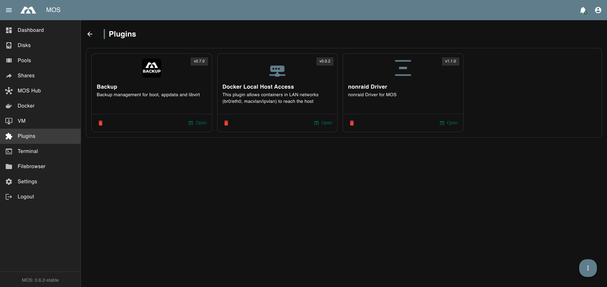
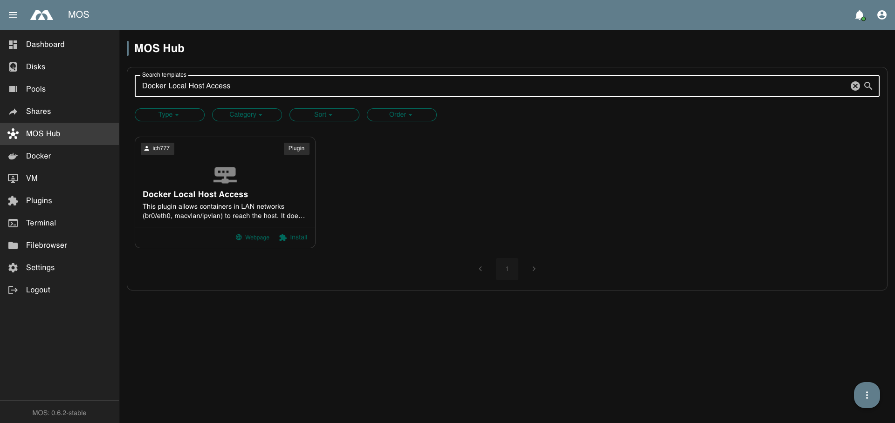
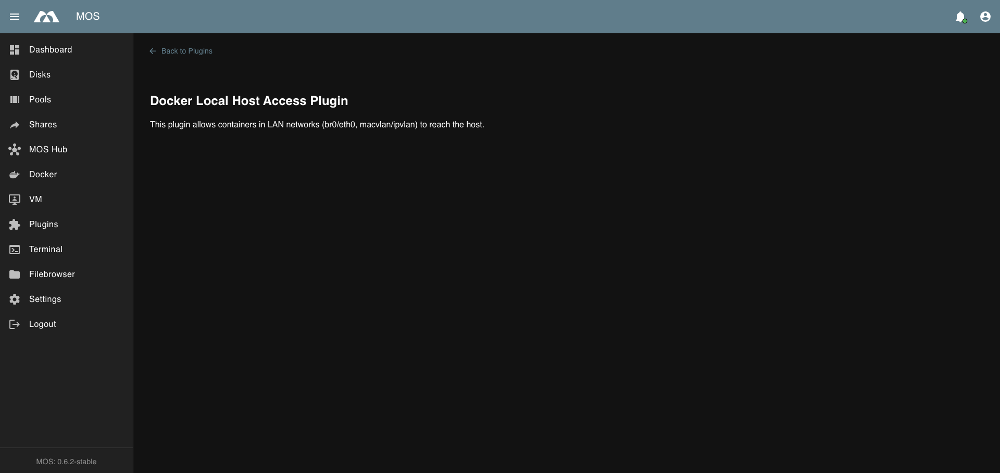

# Docker Local Host Access (Host Shim)

When using Docker containers in **LAN network modes** (e.g. `br0` / `eth0` with `macvlan` or `ipvlan`), containers may not be able to reach the host system directly.

The **Docker Local Host Access** plugin solves this by creating a small **shim interface** on the host, enabling containers on these LAN networks to access the MOS host.

---

## ✅ What Changed?

This feature was previously provided as a manual script (`shim_bridge.sh`).

It is now shipped as an official **MOS Plugin**:
- No manual script setup
- No Cron job required
- Install once → active automatically
- Release selection is handled via MOS Hub (like any other plugin)

---

## 📍 Where to Find the Plugin

Go to:

**MOS Hub → Search**  
Look for: **Docker Local Host Access**

This plugin is maintained by **ich777** and is part of the official MOS template collection.
The source repository can be found here:  
https://github.com/ich777/mos-templates

---

## ⬇️ Installation

- Open MOS Hub

- Select Docker Local Host Access

- Click Install

- Choose the desired release version

- Confirm the installation

After installation, the plugin is active automatically.

---

## 🧩 After Installation

The plugin will appear under:

> **Plugins**

From there you can see that it is installed and open the plugin page.

---

## ⚙️ Configuration

This plugin does not provide a configuration UI.

Once installed, it automatically applies the required host shim setup based on the system configuration.

---

---

_Parts of this documentation were created with the assistance of AI tools. All AI-generated content has undergone review, but it may still contain inaccuracies, omissions, or outdated information._
