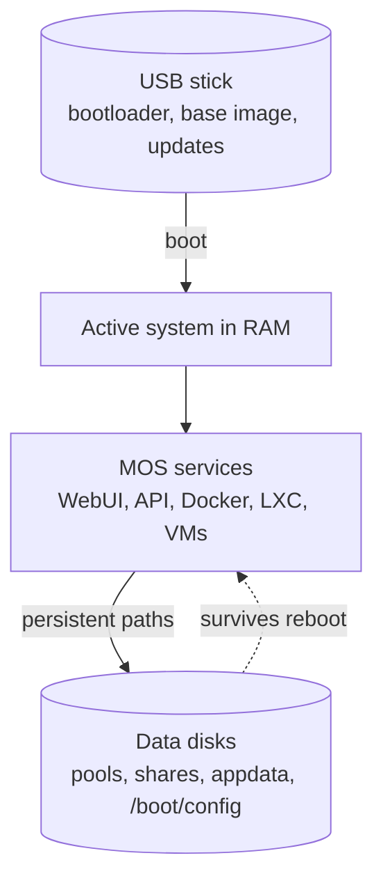

# 🧠 System Architecture

MOS is designed as a lightweight, USB-based operating system.



## 🔄 Runs in RAM

After boot, the MOS system runs entirely in RAM.

The USB stick is used only for:

- Bootloader
- Base system image
- Updates

The active system itself is not permanently written to disk during runtime.

---

## 💾 What Does This Mean?

Any changes made:

- Outside configured storage
- Outside persistent mount points
- Inside temporary system paths

will not survive a reboot.

This includes manually created directories in locations such as:
```text
/root
/home
/tmp
/var
```

Unless they are part of a persistent storage mount.

---

## 📁 Use Persistent Storage Paths

When creating folders, storing data, or configuring services, always use:

- Mounted disks
- Pools
- Configured storage locations
- Relative paths within persistent storage

Example (recommended):
```text
/mnt/cache/appdata/
```

---

## 💾 What Is Stored on the USB Stick?

The MOS USB device is not only used for booting.

It also stores:

- ⚙️ System configuration
- 🌐 WebUI settings
- 🔌 Plugin state and configuration
- 🔑 Network configuration
- 🔄 Update data

These MOS-managed configurations are persistent across reboots.

---

## 📌 Why MOS Works This Way

MOS is designed for:

- 🔋 Power-efficient homelabs
- 💽 USB-based deployment
- 🧼 Clean and reproducible system state
- 🔄 Safe upgrades

Running from RAM ensures:

- Reduced disk wear
- Fast boot times
- Clean system state after reboot

---

## ⚠️ Common Confusion

If folders disappear after reboot, they were most likely created in a non-persistent location.

MOS itself preserves its configuration — but user-created data must be stored on proper storage devices.

---

_Parts of this documentation were created with the assistance of AI tools. All AI-generated content has undergone review, but it may still contain inaccuracies, omissions, or outdated information._
