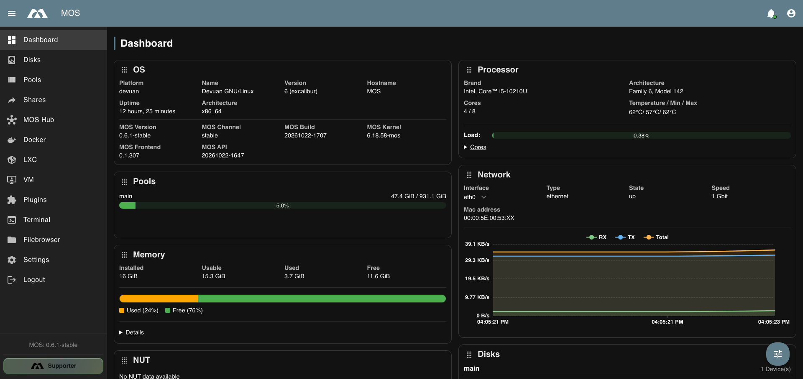
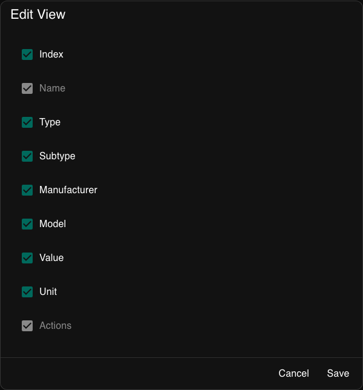

# 🖥️ WebUI Overview

The MOS web interface provides a centralized management dashboard for monitoring system health, managing storage, and operating services such as Docker, LXC, and virtual machines. The interface is divided into three main areas:

| Area | Description |
|---|---|
| **Top Bar** | Global status and quick access |
| **Left Navigation Menu** | Main system sections |
| **Main Content Area** | Detailed views and controls |

---

---

## 🔝 Top Bar

The top bar is always visible and provides quick access to global functions.

- **Notifications** — Displays system alerts, warnings and important events.
- **User Settings** — Displays user profile settings such as “Dark Mode”, “Language”, etc.

---

## 🧭 Left Navigation Menu

The navigation menu on the left provides access to all major system components.

### 📊 Dashboard

The main system overview page. This is the first place to check overall system health.

Displays real-time information about:

- Operating system and MOS version
- CPU load and per-core utilization
- Memory usage
- Network traffic
- Storage pool usage
- Disk activity and temperatures
- Sensors

### 💽 Disks

Lists all detected physical storage devices. Here you can:

- View disk health and temperatures
- Identify devices

### 🗄️ Pools

Used to create and manage storage pools. From this section you can:

- Create new pools
- Assign disks to pools
- Monitor pool usage and status

:::tip
Pools are the foundation for shares, containers and virtual machines.
:::

### 📂 Shares

Manages shared folders provided by the system. Typical use cases:

- Network shares (SMB / NFS)
- Media storage
- Backup destinations

:::note
Shares are always backed by a storage pool.
:::

### 🛍️ MOS Hub

Central place for Docker Templates, Docker Compose Templates and MOS Plugins.

### 🐳 Docker

Manages Docker containers and images. From this section you can:

- Deploy containers
- Start, stop and update services
- Monitor container resource usage

Common use cases include media servers, download services and automation tools.

### 📦 LXC

Manages Linux Containers (LXC). Used for:

- Lightweight system containers
- Isolated service environments
- Advanced Linux-based workloads

:::tip
LXC containers behave more like small virtual systems compared to Docker containers.
:::

### 🖥️ VMs

Manages full virtual machines. Here you can:

- Create and manage virtual machines
- Assign CPU, memory and storage
- Run complete operating systems

Best suited for workloads that require a full OS.

### 👤 Users

User and permission management. Allows you to:

- Create and manage user accounts
- Assign access rights
- Control permissions for shares and services

### 🔧 Tools

Provides tools for MOS:

- Power Management (Reboot and Shutdown)
- Terminal
- Filebrowser

### 👨‍💻 User Settings

Personal settings for the currently logged-in user. Includes:

- Interface preferences
- Account-related options

### ⚙️ Settings

Global system configuration. This section is used to configure:

- Network settings
- System behavior
- Security and access control
- Advanced MOS features

### 🚪 Logout

Ends the current session and returns to the login screen.

---

## 📋 Dashboard Panels Overview

The Dashboard displays multiple information panels providing a real-time system overview.

| Panel | Description |
|---|---|
| **OS Panel** | Displays operating system details, MOS version, kernel, uptime and hostname |
| **Processor Panel** | Shows CPU model, architecture, temperature, load and per-core utilization |
| **Memory Panel** | Visual overview of RAM usage, including system processes, Docker, LXC, cache and free memory |
| **Network Panel** | Displays real-time network traffic for active interfaces |
| **Pools Panel** | Shows storage pool usage and capacity |
| **Disks Panel** | Displays disk activity and temperature for active devices |
| **Plugin Widgets** | Additional dashboard panels provided by installed plugins (e.g. DVB drivers, Nvidia GPU, Sensors) |

---

## 🧩 Plugin Widgets

Plugins can provide additional dashboard widgets that display relevant information directly on the Dashboard.

Examples shown above include DVB adapter info, GPU stats (Nvidia), temperature, voltage and other sensor data.

### Visibility Control

Each plugin widget can be toggled on or off individually using the **visibility menu** in the bottom right corner of the Dashboard.

:::tip
Not all plugins support dashboard widgets. Only plugins that provide widget support will appear in the visibility menu.
:::

---

## 🔐 Login Rate Limits {#login-rate-limits}

The WebUI implements rate limits for the login area to protect the system from brute-force attacks.

### Configuration

Login rate limits are configured via environment variables in the file `/boot/config/api/env`.

| Variable | Default Value | Description |
|----------|---------------|-------------|
| `RATE_LIMIT_MAX_LOGIN` | 5 | Maximum number of failed login attempts |
| `RATE_LIMIT_LOGIN_WINDOW` | 15 | Time window in minutes during which the maximum attempts are allowed |
| `RATE_LIMIT_LOGIN_BLOCK` | 30 | Block duration in minutes after exceeding the limits |

### How It Works

1. A user has `RATE_LIMIT_MAX_LOGIN` (default: 5) login attempts within `RATE_LIMIT_LOGIN_WINDOW` (default: 15 minutes)
2. After exceeding the limit, the account is blocked for `RATE_LIMIT_LOGIN_BLOCK` (default: 30 minutes)
3. The counter is reset in the following cases:
   - API restart
   - Server restart
   - Successful login

### Example

Default configuration:
- Maximum of 5 failed login attempts in 15 minutes
- After 5 failed attempts: 30 minutes block

:::warning Important
Changes to the configuration require a restart of the API or the server to take effect.
:::

---

## 📱 Install as an App and Enable Push Notifications

MOS is a Progressive Web App (PWA). Installing it gives you an app icon, a
standalone window and — on mobile devices — push notifications.

### Install

- **Android / Desktop (Chrome, Edge):** click the install icon in the address bar.
- **iOS / iPadOS (Safari):** tap **Share → Add to Home Screen**.

### Push notifications

After you log in, MOS tries to subscribe the browser for push notifications and the
browser asks for permission. Some browsers only show this prompt after a user
interaction, and some block automatic requests entirely.

If no prompt appears:

1. Open the browser's site settings for the MOS address.
2. Allow **Notifications**.
3. Reload the WebUI and log in again — MOS subscribes the browser on login.

:::warning[HTTPS is required]
Push notifications only work in a secure context. Access the WebUI via **HTTPS**
(the self-signed certificate can be downloaded under Settings → System → Web UI).
Plain HTTP works for the interface itself, but not for push — the only exception is
`localhost`.
:::

:::note[iOS]
Push notifications require iOS/iPadOS 16.4 or later and a WebUI installed via
**Add to Home Screen**. In a normal Safari tab, iOS does not deliver web push.
:::

If notifications do not arrive:

1. Check the browser's site settings and allow notifications for the MOS address.
2. Make sure the WebUI is open at least once after installing the PWA.
3. Remove the subscription by logging out, then log in again to re-subscribe.

---

## 🔔 Notification List

The bell icon in the top bar opens the list of notifications received by MOS.
A badge shows the number of unread entries.

| Element | Behaviour |
|---------|-----------|
| Severity icon | Info, warning or error, depending on the notification |
| Title and message | Short summary and details of the event |
| Timestamp | When the notification was created |
| **Newer / Older** | Switches the sort order of the list |
| **Mark all as read** | Marks every entry as read after confirmation |

Unread notifications are shown in bold. Selecting an entry opens it and marks it
as read.

:::note
The notification list only shows events that were delivered to MOS. Which events
are sent, and to which providers, is configured under
[Settings → Notifications](/docs/Settings/System-Configuration/Notifications).
:::

---

## ✅ Summary

The MOS WebUI is designed to provide:

- Immediate visibility into system health
- Clear separation of storage, services and virtualization
- Scalability from simple setups to advanced server configurations

For most users, daily interaction will focus on:

**Dashboard → Pools → Shares → Docker → Settings**

---

_Parts of this documentation were created with the assistance of AI tools. All AI-generated content has undergone review, but it may still contain inaccuracies, omissions, or outdated information._
