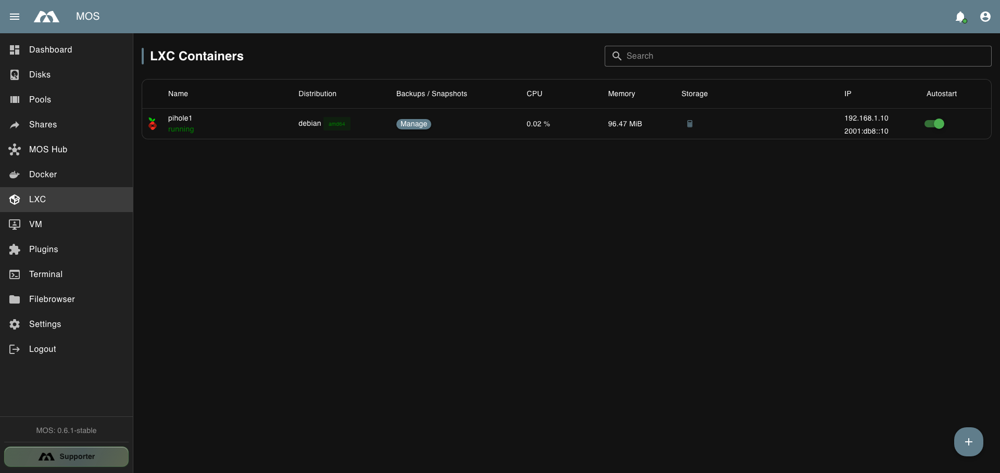

# 📋 LXC Container Overview

The **LXC** page lists all containers on the system and their current state.

*The LXC container list.*

| Column | Description |
|--------|-------------|
| **Name** | Container name and state |
| **Distribution** | Distribution and architecture, e.g. `debian` / `amd64` |
| **Backups / Snapshots** | Opens the container's **Manage** view |
| **CPU** | Live CPU usage while running |
| **Memory** | Current memory usage |
| **Storage** | Root filesystem usage. Click the calculator button to calculate it on demand |
| **IP** | IPv4 and IPv6 address of the container |
| **Autostart** | Whether the container starts on boot |

The calculator button in the **Storage** column queries the root filesystem size on
demand; the value is not refreshed automatically.

---

_Parts of this documentation were created with the assistance of AI tools. All AI-generated content has undergone review, but it may still contain inaccuracies, omissions, or outdated information._
