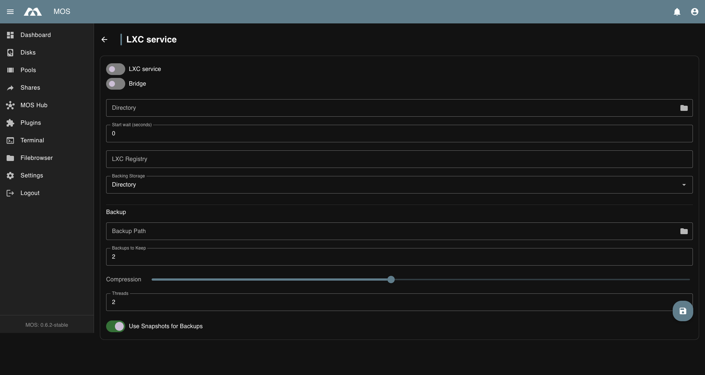

# 📦 LXC Service

The **LXC Service** menu controls the global configuration of Linux Containers (LXC).  
It allows you to enable or disable the LXC service, configure container networking, and define storage locations for LXC containers.

The **LXC Service** menu is located under:

**Settings → Virtualization → LXC Service**

Changes in this section affect all LXC containers on the system.

Example:

---

## ⚙️ LXC Service Configuration

### Enable LXC Service

Enables or disables the LXC service.

**Enabled:**
- LXC containers can be created and started
- LXC management features are available

**Disabled:**
- All LXC containers are stopped
- No LXC-related services are running

:::note
Disabling the LXC service will stop all running LXC containers.
:::

---

### Bridge

Controls whether the LXC network bridge is enabled.

**Options:**
- Enable
- Disable

**Enabled:**
- LXC containers are connected via a virtual bridge
- Containers can communicate with each other
- Provides network connectivity for containers

**Disabled:**
- No bridge-based networking for LXC containers
- Containers may require alternative networking configuration

:::tip
Bridge mode is recommended for most setups.
:::

---

### LXC Directory

Defines the directory used to store LXC container data.

**Purpose:**
- Container root filesystems
- Configuration files
- Snapshots and metadata

:::tip
- Use a fast and reliable storage pool
- Ensure sufficient disk space
- Include this directory in regular backups
:::

---

### Start Wait (seconds)

Delay in seconds before the LXC service starts its containers after boot.

- `0` disables the delay (default).
- Increase it when containers depend on storage that is mounted late, for example a
  pool that needs to be unlocked or imported.

---

### LXC Registry

URL of the LXC image registry used for `lxc-create` downloads.

- Leave empty to use the default, `images.linuxcontainers.org`.
- Set a mirror URL when the default registry is slow or unreachable.

---

## 💾 Backups & Snapshots

Each container is managed individually via the **Manage** button in the container
list. The **Manage** view contains the container's backups, snapshots and restore
actions.

The defaults below apply to every container. They can be overridden per container
when a backup is created.

### Backup Defaults

| Setting | Default | Description |
|---------|---------|-------------|
| **Backup Path** | Pool-dependent | Directory where container backups are stored |
| **Backups to Keep** | `3` | Number of backups kept per container; older ones are removed |
| **Compression** | `6` | xz compression level from `0` (none) to `9` (maximum) |
| **Threads** | `0` | Worker threads for compression. `0` uses half of the available CPU cores |
| **Use Snapshots for Backups** | off | Back up from a btrfs snapshot so the container keeps running. Ignored for containers with **Directory** backing storage |

### Backing Storage

Defines how container root filesystems are stored.

| Option | Description |
|--------|-------------|
| **Directory** | Each container is a directory below the **LXC Directory** (default) |
| **Btrfs** | Each root filesystem is a btrfs subvolume. Required for snapshot-based backups |

Btrfs backing storage requires the **LXC Directory** to be on a btrfs filesystem.

### Backups

The **Backups** tab shows all created backups for the container.

- Backups are stored as compressed archives
- Each backup captures the container's filesystem and configuration
- Click **Create Backup** to manually create a backup
- Existing backups can be restored or deleted

:::tip
Schedule regular backups using Cron Jobs (Settings → System Configuration → Cron Jobs) to automate the backup process.
:::

### Snapshots

The **Snapshots** tab shows all created snapshots for the container.

- Snapshots are point-in-time copies of the container's state
- Creating a snapshot is faster than a full backup
- Snapshots can be used to quickly roll back to a previous state
- Click **Create Snapshot** to manually create a snapshot

:::info
Snapshots require a filesystem that supports them (e.g., btrfs or ZFS). On other filesystems, snapshots may not be available.
:::

---

## 📝 Operational Notes

- Network connectivity depends on bridge configuration
- Changes to the LXC directory may require restarting the LXC service
- Existing containers are not moved automatically if the directory is changed

---

## ✅ Summary

The LXC Service settings define how Linux Containers operate on the system.

**Key points:**
- Enable or disable the LXC service
- Control bridge-based container networking
- Define the storage location for LXC containers

Proper configuration ensures stable and predictable LXC container operation.

---

_Parts of this documentation were created with the assistance of AI tools. All AI-generated content has undergone review, but it may still contain inaccuracies, omissions, or outdated information._
