# 🔌 Network Services

MOS provides various network services for remote access, file sharing, and VPN connectivity. These can be managed through:

**Settings → Network → Network Services**

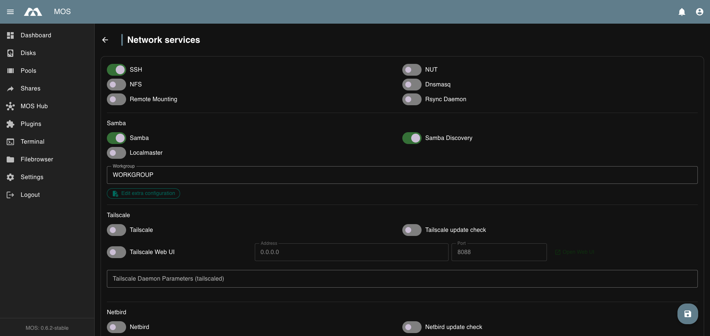

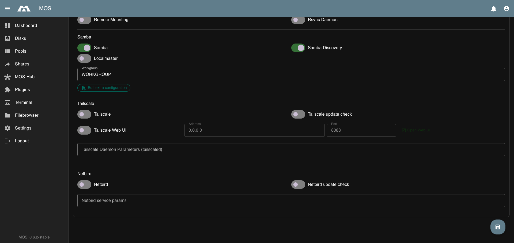

---

## 🔒 SSH

Enable SSH access to remotely manage your MOS system via command line.

When enabled, you can connect using any SSH client:
```bash
ssh root@<MOS-IP-ADDRESS>
```

---

##  NFS

Network File System (NFS) allows Linux/Unix systems to mount shares from MOS.

Enable NFS to share directories with other systems on your network.

---

## 🌍 Dnsmasq

Lightweight DNS forwarder and DHCP server.

Enable Dnsmasq for local DNS resolution and DHCP services.

---

## 🔋 NUT (Network UPS Tools)

NUT (Network UPS Tools) lets MOS monitor and manage UPS (Uninterruptible Power Supply) devices connected via USB or serial port. It provides live battery and status information and can trigger a graceful shutdown of the system (and selected workloads) when mains power is lost.

Everything is configured directly in the WebUI — you no longer need to edit configuration files by hand.

:::info
The NUT **service** itself is enabled or disabled under **Settings → Network → Network Services**. All remaining NUT settings are configured on the dedicated **NUT** page under **Settings → Network**.
:::

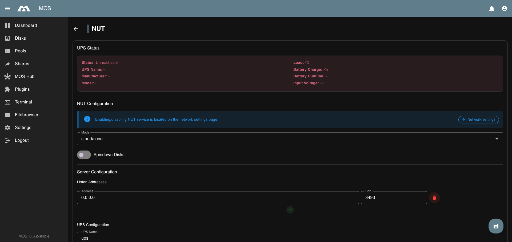

*The NUT page with UPS status and configuration sections.*

### 🚀 Quick Start

1. Enable NUT under **Settings → Network → Network Services**
2. Open the **NUT** page under **Settings → Network**
3. Select the **Mode** (`standalone` for a locally connected USB/serial UPS)
4. Under **UPS Configuration**, set the **UPS Name**, the **Driver** (e.g., `usbhid-ups`) and the **Port** (`auto` for USB)
5. Adjust **Shutdown Configuration** and, if desired, **Stop Services on Battery**
6. Click the save (floating action) button and verify the **UPS Status** card shows live values

### 📊 UPS Status

The **UPS Status** card at the top of the page shows live values queried from the UPS:

| Field | Description |
|-------|-------------|
| **Status** | Raw UPS status flags (e.g., `OL` = online, `OB` = on battery, `LB` = low battery) |
| **UPS Name** | Name of the configured UPS |
| **Manufacturer** | UPS manufacturer (when reported) |
| **Model** | UPS model (when reported) |
| **Load** | Current load in percent |
| **Battery Charge** | Battery charge in percent |
| **Battery Runtime** | Estimated remaining runtime |
| **Input Voltage** | Mains input voltage |

:::note
The status shows as `Unreachable` when NUT is disabled or the UPS daemon (`upsd`) cannot be queried — the card then displays a connection error (e.g., `Connection refused`).
:::

### ⚙️ Mode

The **Mode** dropdown selects the NUT operating mode:

| Mode | Description |
|------|-------------|
| `standalone` | Single UPS protecting the local MOS system (most common) |
| `netserver` | UPS server that shares its UPS with other systems on the network |
| `netclient` | Client that monitors a remote UPS over the network (no local UPS) |
| `none` | NUT does not run (equivalent to disabling it) |

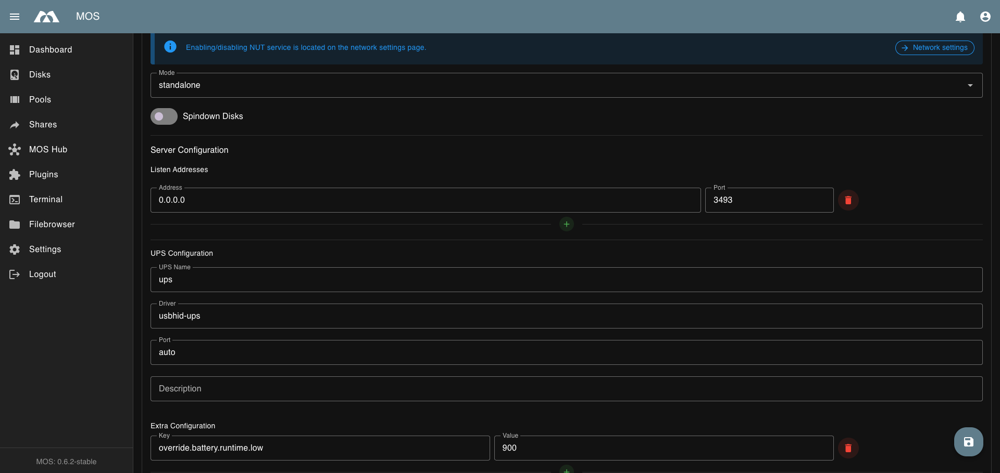

*The available NUT modes.*

#### Spindown Disks

Toggle **Spindown Disks** to put all spin-capable disks into standby when the UPS reports an **ONBATT** (on battery) event. This lowers power draw and protects the disks during an outage.

### 🖥️ Server Configuration (standalone / netserver)

In `standalone` and `netserver` mode, MOS manages the UPS device(s) and the NUT server settings directly — this replaces the former `ups.conf`, `upsd.conf` and `upsd.users` files.

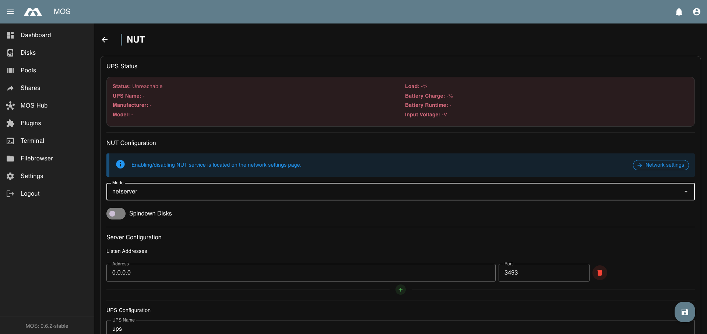

*Server and UPS configuration in netserver mode.*

#### Listen Addresses

Defines where the NUT server (`upsd`) accepts connections (equivalent to `LISTEN` in `upsd.conf`):

| Field | Description |
|-------|-------------|
| **Address** | IP address to listen on (`0.0.0.0` = all interfaces) |
| **Port** | TCP port (default: `3493`) |

- Click **+** to add another listen address
- Click the red delete icon to remove an entry

#### UPS Configuration

Defines the UPS device(s) to monitor (equivalent to `ups.conf`):

| Field | Description |
|-------|-------------|
| **UPS Name** | Name of the UPS, e.g., `ups` |
| **Driver** | NUT driver matching your UPS (e.g., `usbhid-ups` for USB HID devices) |
| **Port** | Device port — `auto` for USB, or a serial device such as `/dev/ttyS0` |
| **Description** | Optional description for the UPS |
| **Extra Configuration +** | Additional driver options as key/value pairs (e.g., `pollinterval`, `maxretry`, `retrydelay`) |

#### Users

Defines NUT users and their permissions (equivalent to `upsd.users`). Click **+** to add a user:

| Field | Description |
|-------|-------------|
| **Username** / **Password** | Credentials for the user |
| **Actions** | Allowed actions, e.g., `SET` (change UPS variables) and `FSD` (force shutdown) |
| **Instcmds** | Allowed instant commands (`ALL` = all commands) |
| **upsmon** | Monitoring role: `primary` (formerly `master`), `secondary` (formerly `slave`), or none |

### 📡 Monitor Configuration (netclient)

In `netclient` mode, MOS monitors a remote UPS instead of a locally connected one (equivalent to the `MONITOR` line in `upsmon.conf`):

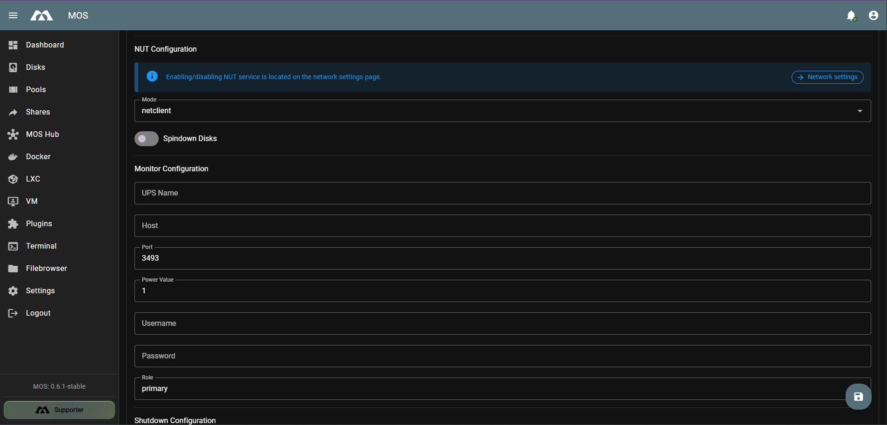

*Monitor configuration in netclient mode.*

| Field | Description |
|-------|-------------|
| **UPS Name** | Name of the UPS on the remote NUT server, e.g., `ups` |
| **Host** | IP address or hostname of the remote NUT server |
| **Port** | NUT port of the remote server (default: `3493`) |
| **Power Value** | Number of power supplies this UPS feeds (default: `1`) |
| **Username** / **Password** | Credentials defined on the remote NUT server |
| **Role** | `primary` (formerly `master`) or `secondary` (formerly `slave`) |

### 🛑 Shutdown Configuration

Controls how and when MOS shuts down on a critical power event (equivalent to the shutdown options in `upsmon.conf`):

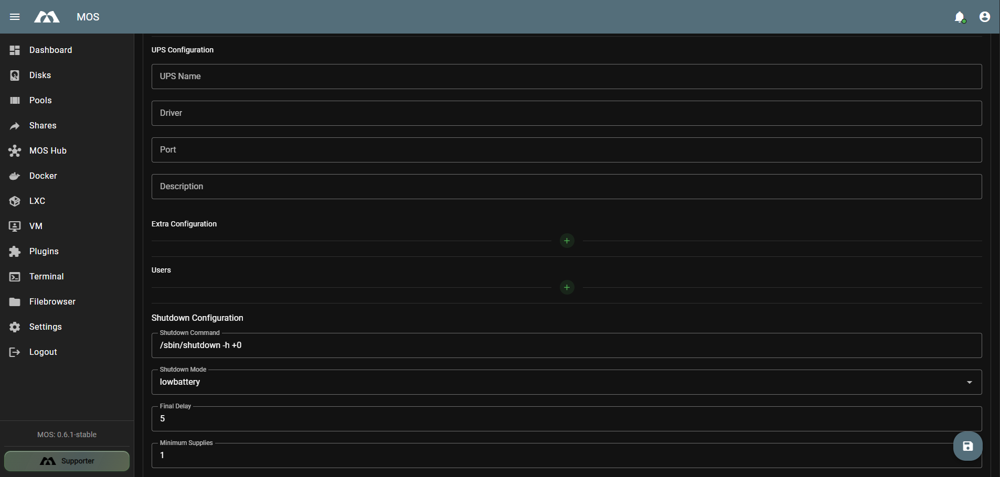

*UPS configuration, users, and shutdown configuration.*

| Field | Default | Description |
|-------|---------|-------------|
| **Shutdown Command** | `/sbin/shutdown -h +0` | Command executed on a critical power event |
| **Shutdown Mode** | `lowbattery` | When to shut down: `lowbattery` (when the UPS reports low battery) or `timer` (after a fixed time on battery) |
| **Timer Seconds** | — | Time on battery before shutdown — only shown when **Shutdown Mode** is `timer` |
| **Final Delay** | `5` | Seconds to wait before shutdown after the `SHUTDOWN` event |
| **Minimum Supplies** | `1` | Minimum number of power supplies that must be online to keep running |
| **Powerdown Flag** | `/etc/killpower` | File used to signal that the UPS should cut power after shutdown |

### ⏱️ Timers

Fine-tune polling and timeout behaviour (equivalent to `POLLFREQ`, `DEADTIME`, etc.):

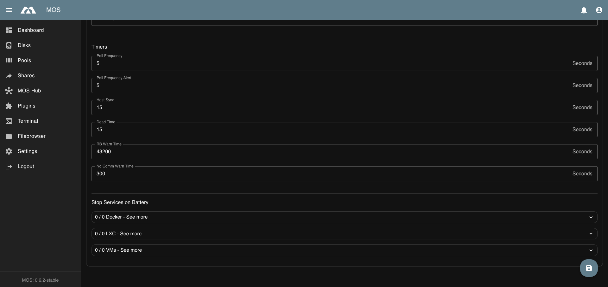

*Timers and workload shutdown settings.*

| Field | Default | Description |
|-------|---------|-------------|
| **Poll Frequency** | `5` seconds | How often `upsmon` polls the UPS |
| **Poll Frequency Alert** | `5` seconds | Poll frequency while an alert condition is active |
| **Host Sync** | `15` seconds | How often secondary hosts synchronise with the primary |
| **Dead Time** | `300` seconds | Time without a valid response before the UPS is declared dead |
| **RB Warn Time** | `43200` seconds | Reboot warning interval |
| **No Comm Warn Time** | `60` seconds | Time without communication before a warning is raised |

### 🔌 Stop Services on Battery

When the UPS switches to battery (**ONBATT**), MOS can stop selected workloads to save power and shut them down gracefully. Stopped workloads are restarted when power returns (**ONLINE**) — but only if they were running before the outage.

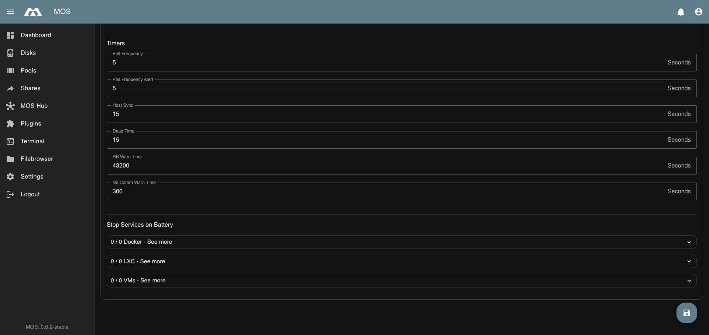

*Workloads (Docker containers, LXC containers, VMs) to stop on battery.*

- **Docker** — toggle individual containers
- **LXC** — toggle individual containers
- **VMs** — toggle individual virtual machines

Expand a category to show its entries, then enable the toggle next to each workload you want stopped on battery.

### 📜 Event Scripts

Custom scripts can be attached to NUT events. They are stored under:

```
/boot/config/system/nut/<event>.sh
```

Supported events (case-insensitive): `ONLINE`, `ONBATT`, `SHUTDOWN`, `LOWBATT`, `FSD`, `COMMBAD`, `NOCOMM`, `NOPARENT`, `REPLBATT`.

The scripts run directly from the boot stick when the event fires, so changes take effect immediately without restarting NUT.

### 🧰 Common UPS Drivers

| Manufacturer | Driver | Notes |
|--------------|--------|-------|
| APC | `usbhid-ups` | Most modern APC units |
| APC (older) | `apcsmart` | Smart-UPS via serial |
| CyberPower | `usbhid-ups` | Most USB models |
| Eaton | `usbhid-ups` | Various models |
| Tripp Lite | `usbhid-ups` | USB HID models |
| Tripp Lite | `tripplite` | Serial models |
| Generic USB | `usbhid-ups` | HID-compliant devices |

### 🧪 Testing NUT

After enabling NUT and configuring your UPS, verify the setup from the **MOS Terminal**:

```bash
# Check UPS status
upsc ups@localhost

# List available commands
upscmd -l ups@localhost

# Test battery (if supported)
upscmd ups@localhost test.battery.start
```

### 🛠 Troubleshooting

- **UPS unreachable / "Connection refused":** Ensure the NUT service is enabled in **Network Services** and the UPS daemon (`upsd`) is running
- **UPS not detected:** Verify the USB/serial connection and that the selected **Driver** matches your UPS
- **Permission denied:** Check the **Users** entries and their actions/instcmds
- **No shutdown:** Verify **Shutdown Command**, **Shutdown Mode** and **Minimum Supplies**
- **Stale data:** Adjust the **Timers** (e.g., **Dead Time**) as needed

---

## 📀 Remote Mounting

Mount remote storage to your MOS system.

Enable to access storage from other servers or NAS devices.

---

## 🔄 Rsync

Rsync is a fast, incremental file-synchronisation tool. Enabling the **Rsync Daemon** turns MOS into an rsync server so that other systems can synchronise data to or from your shares over the network.

:::info
The Rsync **daemon** is enabled or disabled under **Settings → Network → Network Services**. The daemon configuration is edited on the dedicated **Rsync** page under **Settings → Network**.
:::

The Rsync page shows a single **Content** editor for the `rsyncd.conf` file, stored at:

```
/boot/config/system/rsync/rsyncd.conf
```

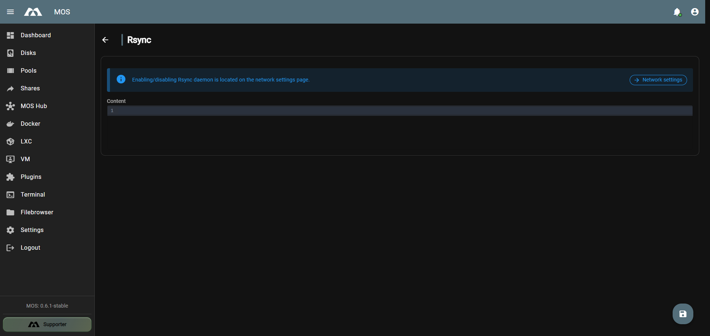

*The Rsync page with the rsyncd.conf content editor.*

### Configuring rsyncd.conf

Enter the rsync daemon configuration in the **Content** editor and click the save (floating action) button. When the content changes and the daemon is enabled, the service is restarted automatically.

A minimal module definition looks like this:

```ini
[data]
  path = /mnt/pool/data
  read only = no
```

| Directive | Description |
|-----------|-------------|
| `[name]` | Module name clients connect to (e.g., `rsync://host/data`) |
| `path` | Absolute path of the directory to expose |
| `read only` | `yes` = clients may only download, `no` = clients may also upload |
| `comment` | Optional description shown in the module list |
| `auth users` / `secrets file` | Restrict access to specific users with a password file |

:::tip
The daemon listens on the standard rsync port `873`. Make sure your firewall allows access from the clients that should synchronise with MOS.
:::

---

## 🗂️ Samba (SMB/CIFS)

Windows-compatible file sharing.

### Samba
Enable Samba to share folders with Windows, macOS, and Linux systems.

### Samba Discovery
Enable network discovery for automatic detection of MOS shares.

### Workgroup
Configure the workgroup name for your network (default: `WORKGROUP`).

### Localmaster
Enable **Localmaster** to make MOS act as the Samba **local master browser** for its workgroup. This helps Windows clients keep an up-to-date list of computers and shares on the network.

:::note
Only one host per workgroup should be the local master browser. Enable this on MOS only if no other server already provides this role.
:::

### Edit Extra Configuration
Use **Edit extra configuration** to add custom options to the generated Samba configuration without editing files by hand. The dialog provides two editors:

| Editor | Purpose | Stored as |
|--------|---------|-----------|
| **Global Configuration** | Extra options for the `[global]` section (e.g., veto files) | `global_extra.conf` |
| **Shares Configuration** | Extra options applied to the share definitions | `shares_extra.conf` |

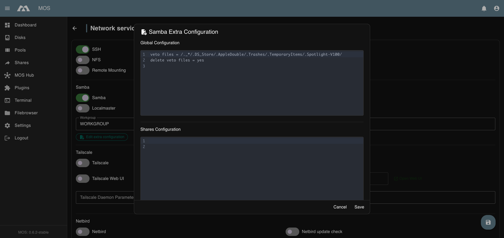

*The Samba Extra Configuration dialog with default global options.*

Both files are stored under `/boot/config/system/samba/` and are included in the generated `smb.conf`. When the content changes and Samba is enabled, `smbd` is restarted (and `nmbd`/`wsddn` if Samba Discovery is enabled). Click **Save** to apply or **Cancel** to discard.

---

## 🌐 Tailscale

[Tailscale](https://tailscale.com/) is a zero-config VPN that creates a secure mesh network between your devices.

### Enabling Tailscale

1. Go to **Settings → Network → Network Services**
2. Toggle **Tailscale** to enable the service

### Setup

After enabling Tailscale, open the **MOS Terminal** and run:

```bash
tailscale up
```

This will generate an authentication URL. Follow the link to authenticate your device with your Tailscale account.

:::tip[CLI Documentation]
For additional options and parameters, refer to the official Tailscale documentation:
[**tailscale up**](https://tailscale.com/docs/reference/tailscale-cli/up)
:::

### Tailscale Update Check

Enable automatic update notifications for Tailscale.

### Tailscale Daemon Parameters

Add custom command-line arguments for the Tailscale daemon (`tailscaled`) if needed.

### Tailscale Web UI

Enable **Tailscale Web UI** to expose the Tailscale web interface for managing your tailnet from the browser.

| Field | Default | Description |
|-------|---------|-------------|
| **Address** | `0.0.0.0` | Interface the Web UI listens on (`0.0.0.0` = all interfaces) |
| **Port** | `8088` | TCP port for the Web UI |

Once enabled, click **Open Web UI** to open the interface in a new browser tab (e.g., `http://<MOS-IP>:8088`).

:::warning
The Tailscale Web UI exposes administrative functions. Only enable it on trusted networks and never forward its port to the public Internet.
:::

---

## 🐦 Netbird

[Netbird](https://netbird.io/) is an open-source peer-to-peer VPN solution with zero configuration.

### Enabling Netbird

1. Go to **Settings → Network → Network Services**
2. Toggle **Netbird** to enable the service

### Setup

After enabling Netbird, open the **MOS Terminal** and run:

```bash
netbird up
```

This will generate an authentication URL. Follow the link to register your device with your Netbird management server.

:::tip[CLI Documentation]
For additional options and parameters, refer to the official Netbird documentation:
[**netbird up**](https://docs.netbird.io/get-started/cli#up)
:::

### Netbird Update Check

Enable automatic update notifications for Netbird.

### Netbird Service Parameters

Add custom configuration parameters for the Netbird service if needed.

---

## 🆘 Troubleshooting

### VPN not connecting?
- Ensure the service is enabled in Network Services
- Check that you've run the `up` command in the MOS Terminal
- Verify your device has internet connectivity
- Check firewall settings if behind a restrictive network

### Can't access shares?
- Verify the sharing service (NFS/Samba) is enabled
- Check share permissions in the **Shares** section
- Ensure client devices are on the same network or VPN

---

_Parts of this documentation were created with the assistance of AI tools. All AI-generated content has undergone review, but it may still contain inaccuracies, omissions, or outdated information._