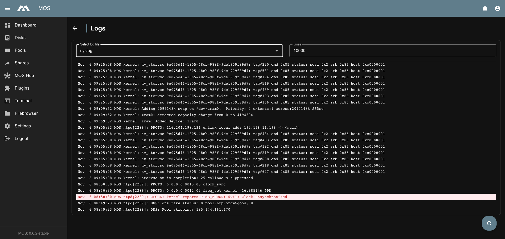

# 📋 Logs

The **Logs** menu provides direct access to system log files stored on the server.  
It allows you to inspect log output for troubleshooting, monitoring, and auditing purposes without using the command line.

The **Logs** menu is located under:

**Settings → System Configuration → Logs**

All log files located in `/var/log` and its subdirectories can be viewed from this interface.

Example:

---

## 📊 Log Viewer Overview

The log viewer lists all available log files found in:

`/var/log`

including files located in nested subdirectories.

**Typical log files include:**
- `api`
- `auth`
- `boot`
- `cron`
- `docker`
- `notify`
- `syslog`
- Application-specific log files
- Custom service logs

---

## ⚙️ Log Viewer Options

### Log File Selection

Select the log file you want to inspect from the list.

:::note
- Only files within `/var/log` are accessible
- Permissions are handled by the system
- Large log files may take longer to load
:::

### Max Log Directory Size

Sets the maximum size of the log directory in megabytes.

**Default value:**
- `200` MB

**Purpose:**
- Prevents logs from filling the root filesystem
- When the limit is reached, the oldest log data is discarded

:::warning
Setting the value too low can remove logs you need for troubleshooting. Keep at least
a few days of history for the services you monitor.
:::

---

### Lines

Defines how many lines of the selected log file are displayed.

**Default value:**
- `10000` → Shows the last 10,000 lines of the file

**Purpose:**
- Limit output for better readability
- Improve performance when viewing large files

:::tip[Best practice]
- Start with a lower number of lines when troubleshooting
- Increase the value only if more context is required
:::

---

## 🎯 Use Cases

- Diagnosing system or service startup issues
- Inspecting cron job output
- Reviewing authentication and access logs
- Debugging application or container behavior

---

## 📝 Notes and Limitations

- Log files are read-only in this view
- Editing or deleting logs is not supported

---

## ✅ Summary

The Logs menu offers a convenient and safe way to inspect system log files.

**Key points:**
- View logs from `/var/log` and subdirectories
- Select specific log files to inspect
- Control the number of displayed lines
- Ideal for debugging and system monitoring

Proper use of log inspection is essential for maintaining a stable and secure system.

---

_Parts of this documentation were created with the assistance of AI tools. All AI-generated content has undergone review, but it may still contain inaccuracies, omissions, or outdated information._
