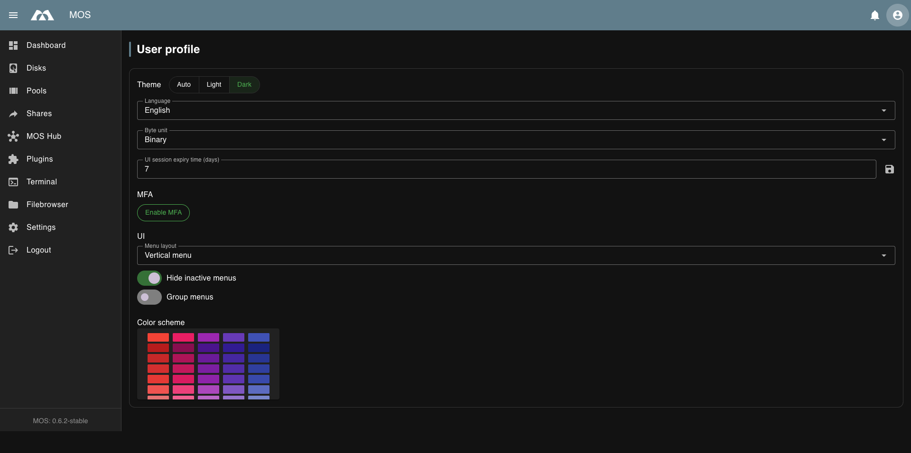
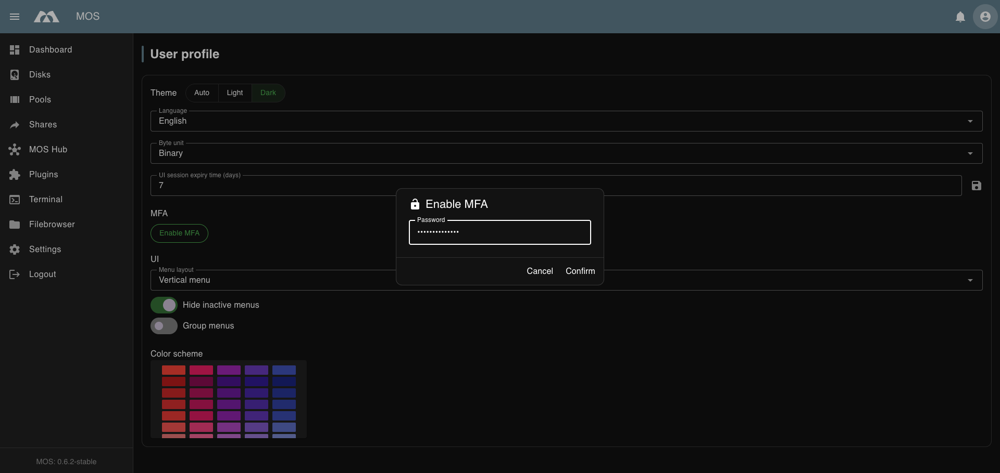
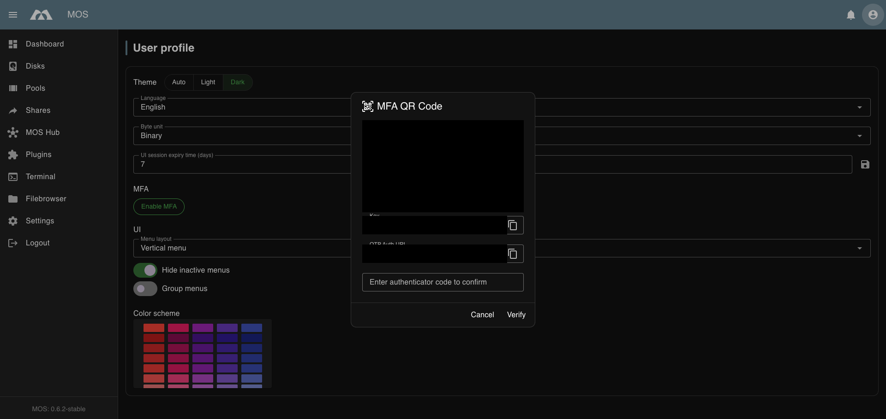
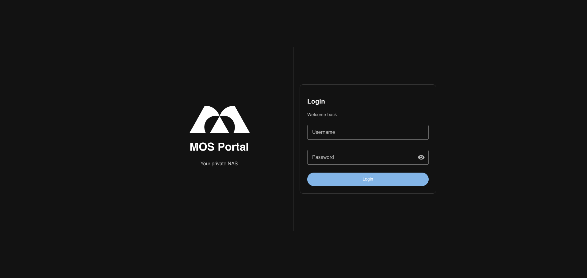
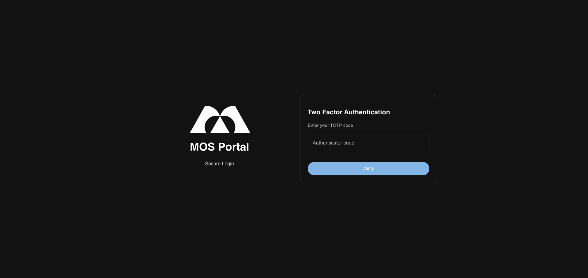
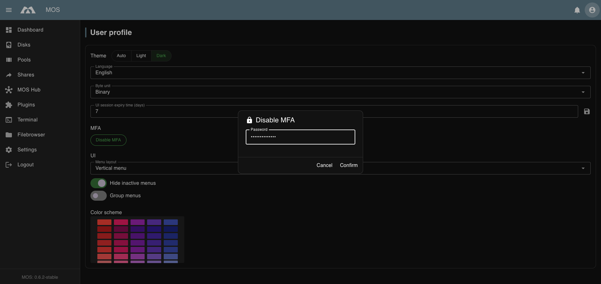
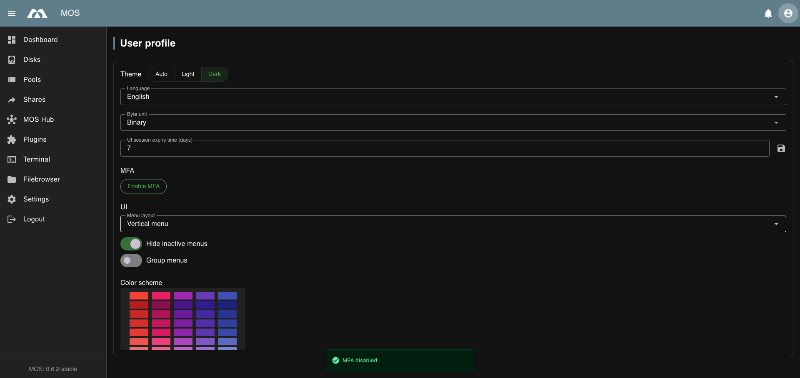

# ⚙️ User Profile

The User Profile menu allows you to customize your personal WebUI experience and interface preferences.

Navigate to:

> **User Settings → User Profile**

Example:

---

## 🌓 Theme

Choose how the WebUI is displayed. The setting is stored per user.

| Option | Behaviour |
|--------|-----------|
| **Auto** | Follows the operating system's light or dark preference and updates when the system theme changes |
| **Light** | Always uses the light theme |
| **Dark Mode** | Always uses the dark theme |

New users start with **Auto**. **Auto** follows the operating system and updates
when the system theme changes; **Light** and **Dark Mode** override the system preference until you switch back to **Auto**.

:::tip
**Auto** is the safest choice on devices that switch themes at sunset. The theme is
applied as soon as the page loads, so there is no flash of the wrong theme.
:::

---

## 🌐 Language

Select the interface language for the WebUI. The setting is stored per user.

Currently available:

| Language | Code |
|----------|------|
| English | `en` — default, fallback for missing translations |
| German | `de` |
| French | `fr` |
| Spanish | `es` |

Untranslated strings fall back to English. Translations are maintained in Weblate;
the language list grows as new translations are completed.

---

## 📊 Byte Unit

Defines how storage sizes are displayed throughout the interface.

Available options:

| Option | Description |
|--------|-------------|
| **Decimal** | Uses decimal prefixes (KB = 1000 bytes, MB = 1000 KB, etc.) |
| **Binary** | Uses binary prefixes (KiB = 1024 bytes, MiB = 1024 KiB, etc.) |

:::note
- Decimal is more intuitive for most users (matches hard drive manufacturer specifications)
- Binary is technically more accurate for computer systems
:::

---

## ⏱️ UI Session Expiry Time (days)

Defines how long your WebUI session remains active before requiring re-authentication.

- **Default:** 7 days
- **Range:** Typically 1-30 days

:::warning[Security Note]
Shorter session expiry times increase security by requiring more frequent re-authentication. Longer times improve convenience but may pose a security risk if you leave your browser unattended.
:::

---

## 🔐 MFA (Multi-Factor Authentication)

MOS supports TOTP-based Multi-Factor Authentication (MFA) to add an extra layer of security to your account. When enabled, you will need to provide a time-based one-time password (TOTP) from your authenticator app in addition to your password when logging in.

### Enabling MFA

1. Click **Enable MFA** in your User Profile
2. Enter your current password to confirm:

3. Scan the displayed QR code with your authenticator app (e.g., Google Authenticator, Authy, or similar)
4. The dialog also displays:
   - **Key** — The TOTP secret key (for manual entry if QR scanning fails)
   - **OTP Auth URL** — The full authentication URL

:::warning[Important]
Store the recovery codes securely. They are your only way to regain access if you lose your authenticator device.
:::

5. Enter the TOTP code from your authenticator app to verify the setup
6. After successful TOTP verification, the **Recovery Code** will be displayed:

7. **Copy the recovery code** and paste it into the input field below to confirm you have saved it
8. Click **Apply** to complete the MFA setup
9. Upon successful completion, you will see a confirmation message:

:::danger Critical
- Recovery codes can only be used once
- Using a recovery code automatically resets your MFA setup — you will need to set up MFA again
- Store recovery codes in a secure location separate from your authenticator device
- You must verify the recovery code during setup to complete MFA activation
:::

### Login with MFA

When MFA is enabled, the login process requires an additional step:

1. Enter your username and password as usual

2. On the Two Factor Authentication screen, enter the TOTP code from your authenticator app

3. Click **Verify** to complete login

:::warning Rate Limits Apply
Failed MFA code attempts count toward the [login rate limits](../../Dashboard/WebUI-Overview#-login-rate-limits). After exceeding the configured maximum attempts (default: 5), your account will be temporarily blocked.
:::

### Using a Recovery Code

If you have lost access to your authenticator device, you can use a recovery code to log in.

1. On the Two Factor Authentication screen, enter a recovery code instead of a TOTP code
2. Click **Verify** to proceed

:::danger[Important]
- Using a recovery code **immediately disables MFA** on your account
- The recovery code can only be used once and is invalidated after use
- After logging in, you will see a notification that MFA has been disabled
:::

You must set up MFA again in your User Profile to restore the additional security layer.

### Common Errors

**Invalid MFA Code**

If you enter an incorrect TOTP code, you will see an error message:

**Troubleshooting:**
- Ensure your device's clock is synchronized correctly
- Wait for a new code to be generated (codes change every 30 seconds)
- Double-check you are using the correct authenticator app

### Disabling MFA

To disable MFA:

1. Click **Disable MFA** in your User Profile
2. Enter your password to confirm:

3. Upon successful confirmation, MFA will be disabled

:::note[Disabling MFA]  
Disabling MFA removes the additional security layer. Only disable MFA if absolutely necessary and ensure your password is strong.
:::

---

## 🧭 Menu Layout

Defines how the main navigation is arranged.

| Option | Description |
|--------|-------------|
| **Vertical menu** | Navigation is shown as a sidebar on the left (default) |
| **Horizontal menu** | Navigation is placed in a bar at the top |

The setting is stored per user.

---

## 🧹 Hide Inactive Menus

Controls the visibility of menu items for features that are not currently active or configured.

- **Enabled:** Menu items for inactive features are hidden from the left navigation
- **Disabled:** All menu items are shown, even if the corresponding feature is not active

:::tip
- **Enable** this option for a cleaner interface that only shows relevant menu items
- **Disable** this option to see all available features and explore the full interface
:::

---

## 📁 Group Menus

Organizes the left navigation menu into collapsible groups.

- **Enabled:** Menu items are grouped into categories (Storage, Network Access, Virtualization, MOS Tools, etc.)
- **Disabled:** All menu items are displayed in a flat list

:::tip
Grouped menus help organize large systems with many features enabled.
:::

---

## 🎨 Color Scheme

Select a custom accent color for the WebUI interface.

The color scheme affects:
- Active menu highlights
- Button accents
- Chart and graph colors
- Selection indicators

Choose from the available color palette to personalize your interface.

---

_Parts of this documentation were created with the assistance of AI tools. All AI-generated content has undergone review, but it may still contain inaccuracies, omissions, or outdated information._
