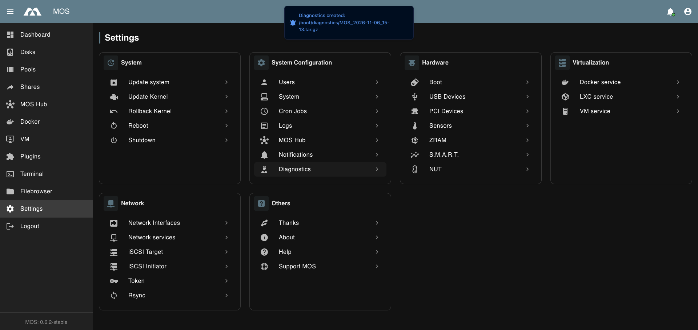

# 🩺 Diagnostics

The Diagnostics feature collects detailed system information and bundles it into a single downloadable archive. This file is useful for troubleshooting issues and sharing system details with the MOS community or support.

---

## 📥 Creating a Diagnostics File

1. Navigate to **Settings → System Configuration → Diagnostics**
2. Click on **Diagnostics** — the file is created immediately and the download starts automatically
3. A notification briefly confirms the file location: `Diagnostics created: /boot/diagnostics/MOS_<date>_<time>.tar.gz`



:::info
The diagnostics file is saved to `/boot/diagnostics/` on the system. Old diagnostics files are not automatically deleted.
:::

---

## 📦 Archive Structure

The diagnostics archive is a `.tar.gz` file named `MOS_YYYY-MM-DD_HH-MM.tar.gz` with the following structure:

## 📦 Archive Structure

The diagnostics archive is a `.tar.gz` file named `MOS_YYYY-MM-DD_HH-MM.tar.gz` with the following structure:

```text
MOS_YYYY-MM-DD_HH-MM.tar.gz
├── mos-release.json        # MOS version & installed packages
├── uname.txt               # Kernel version
├── errors.txt              # Errors encountered during diagnostics collection
├── boot_tree.txt           # Full directory tree of /boot
├── api/                    # Current API state (runtime data)
│   ├── cron.json           # Active cron jobs
│   ├── disks.json          # Detected disks and their status
│   ├── pools.json          # Storage pool status
│   └── shares.json         # Active shares
├── config/                 # System configuration files
│   ├── docker.json         # Docker service configuration
│   ├── lxc.json            # LXC service configuration
│   ├── network.json        # Network configuration
│   ├── pools.json          # Storage pool configuration
│   ├── remotes.json        # Remote mount configuration
│   ├── shares.json         # Share configuration
│   ├── vm.json             # VM service configuration
│   └── system/             # Additional system config
│       ├── cron.json       # Cron configuration
│       ├── hub.json        # MOS Hub configuration
│       ├── proxy.json      # Proxy configuration
│       ├── smart.json      # S.M.A.R.T. configuration
│       ├── zram.json       # ZRAM configuration
│       ├── iscsi/          # iSCSI initiator & target config
│       ├── lxc/            # LXC default container config
│       └── nut/            # NUT (UPS) configuration
├── grub/
│   └── grub.cfg            # GRUB bootloader configuration
├── logs/                   # System logs
│   ├── api.txt             # MOS API log
│   ├── boot.txt            # Boot log
│   └── syslog.txt          # System syslog
├── nfs/
│   └── exports.txt         # Active NFS exports
├── samba/
│   └── testparm.txt        # Samba configuration test output
└── system/                 # Hardware & system info
    ├── aspm.txt            # PCIe ASPM power management info
    ├── bios.txt            # BIOS/UEFI information
    ├── cpu.txt             # CPU details
    ├── cron.txt            # Active cron jobs (system level)
    ├── df.txt              # Disk space usage
    ├── dmesg.txt           # Kernel ring buffer messages
    ├── dri.txt             # DRM/GPU driver info
    ├── lspci.txt           # PCI device list
    ├── lsusb.txt           # USB device list
    ├── memory.txt          # Memory/RAM information
    ├── motherboard.txt     # Motherboard/DMI information
    └── nginx.conf          # NGINX webserver configuration
```

---

## 📋 File Descriptions

### Root Level

| File | Description |
|------|-------------|
| `mos-release.json` | MOS version, build date, frontend/API versions, and a full list of all installed packages with their versions |
| `uname.txt` | Kernel version and build info (e.g. `Linux MOS 6.18.22-mos`) |
| `errors.txt` | Any errors that occurred while generating the diagnostics — useful to check first if something seems missing |
| `boot_tree.txt` | Complete directory tree of the `/boot` partition |

### `api/` — Runtime State

Contains the **live state** of the system as reported by the MOS API at the time of collection.

| File | Description |
|------|-------------|
| `cron.json` | Currently configured cron jobs |
| `disks.json` | All detected disks, their size, type, and health status |
| `pools.json` | Storage pool status including filesystem and mount state |
| `shares.json` | All configured SMB/NFS shares |

### `config/` — Configuration Files

Contains the **raw configuration files** from `/boot/config/`. These are the persistent settings of your MOS installation.

| File | Description |
|------|-------------|
| `docker.json` | Docker daemon settings (storage path, network driver, etc.) |
| `lxc.json` | LXC service settings |
| `network.json` | Network interface configuration (IPs, bonds, VLANs) |
| `pools.json` | Storage pool definitions |
| `remotes.json` | Remote mount definitions |
| `shares.json` | Share definitions (SMB/NFS) |
| `vm.json` | VM service settings (directory, IOMMU, VirtIO) |
| `system/smart.json` | S.M.A.R.T. monitoring configuration |
| `system/zram.json` | ZRAM swap configuration |
| `system/hub.json` | MOS Hub settings |
| `system/proxy.json` | Proxy settings |
| `system/iscsi/` | iSCSI initiator and target configuration |
| `system/lxc/` | LXC default container configuration |
| `system/nut/` | NUT (Network UPS Tools) configuration |

### `logs/` — System Logs

| File | Description |
|------|-------------|
| `api.txt` | MOS API log — helpful for diagnosing WebUI or API issues |
| `boot.txt` | Boot log — shows what happened during the last system startup |
| `syslog.txt` | Full system syslog — the most comprehensive log for general issues |

### `system/` — Hardware Information

| File | Description |
|------|-------------|
| `bios.txt` | BIOS/UEFI vendor, version, and release date |
| `motherboard.txt` | Motherboard manufacturer and model |
| `cpu.txt` | CPU model, cores, threads, and frequency |
| `memory.txt` | RAM size, type, and slot information |
| `lspci.txt` | All PCI/PCIe devices (GPUs, NICs, controllers, etc.) |
| `lsusb.txt` | All connected USB devices |
| `dmesg.txt` | Kernel messages — useful for detecting hardware errors or driver issues |
| `df.txt` | Disk space usage across all mounted filesystems |
| `dri.txt` | GPU/DRM driver information |
| `aspm.txt` | PCIe Active State Power Management info |
| `nginx.conf` | NGINX reverse proxy configuration used by MOS |
| `cron.txt` | System-level cron jobs |

### Other

| File/Folder | Description |
|------|-------------|
| `grub/grub.cfg` | GRUB bootloader configuration — shows kernel boot parameters |
| `nfs/exports.txt` | Active NFS export table |
| `samba/testparm.txt` | Output of `testparm` — validates Samba configuration |

---

## ⚠️ Privacy Notice

The diagnostics archive contains **system configuration and log data**. Before sharing the file publicly or with third parties, review its contents and consider redacting sensitive information such as:

- IP addresses and network configuration (`config/network.json`)
- Share paths and names (`config/shares.json`)
- API tokens or credentials (these are **not** included by default, but check `boot_tree.txt` for reference)
- UPS usernames/passwords (`config/system/nut/`)

:::tip
When reporting a bug or asking for help on [Discord](https://discord.com/invite/fcTMbuygTV), attaching the diagnostics file greatly helps the team identify the issue faster.
:::

---

_Parts of this documentation were created with the assistance of AI tools. All AI-generated content has undergone review, but it may still contain inaccuracies, omissions, or outdated information._
