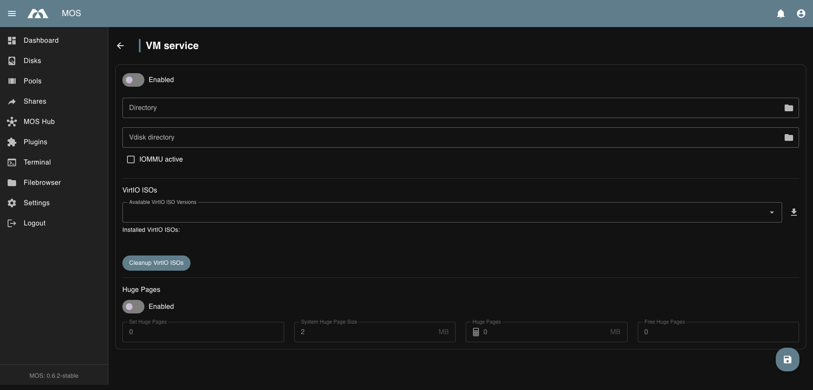

# 🖥️ VM Service

The **VM Service** menu controls the global configuration for virtual machines.  
It allows you to enable or disable the VM service and define storage locations for virtual machine data.

The **VM Service** menu is located under:

**Settings → Virtualization → VM Service**

All settings in this section affect virtual machine operation system-wide.

Example:

---

## ⚙️ VM Service Configuration

### Enable VM Service

Enables or disables the virtual machine service.

**Enabled:**
- Virtual machines can be created and started
- VM-related management features are available

**Disabled:**
- All virtual machines are stopped
- No VM-related services are running

:::note
Disabling the VM service will stop all running virtual machines.
:::

---

### VM Directory

Defines the directory used to store virtual machine configuration data.

**Purpose:**
- VM definitions
- Metadata and configuration files

**Best practices:**
- Use reliable and persistent storage
- Include this directory in regular backups

---

### VDisk Directory

Defines the directory used to store virtual disk images.

**Purpose:**
- Virtual disk (`.img`, `.qcow2`, etc.) files
- VM storage backends

**Best practices:**
- Use fast storage for improved VM performance
- Ensure sufficient disk space
- Consider separate storage pools for disks and configuration

---

### IOMMU

Shows whether IOMMU is active on the host. IOMMU is required for PCI and GPU
passthrough to virtual machines.

- **active** — the kernel reports a usable IOMMU; host devices can be passed through.
- **inactive** — passthrough is not available. Enable IOMMU in the BIOS/UEFI and add
  `intel_iommu=on` or `amd_iommu=on` to the kernel command line.

This is a status indicator, not a setting.

---

## 💿 VirtIO ISOs

Provides access to VirtIO driver ISO images used by virtual machines (primarily for Windows guests).

**Available VirtIO ISO Versions**
Use the dropdown to select the desired VirtIO ISO version, then click the download button (⬇️) to install it.

**Installed VirtIO ISOs**
All currently installed VirtIO ISOs are listed here as chips/badges.

**Cleanup VirtIO ISOs**
Removes all VirtIO ISOs that are not currently in use by any VM.

:::tip
VirtIO drivers are required for Windows VMs to use paravirtualized hardware (disk, network, etc.) for best performance.
:::

---

## 🧠 Huge Pages

Huge Pages back guest memory with 2 MB pages instead of 4 KB pages, which reduces
TLB pressure for memory-heavy VMs.

| Field | Description |
|-------|-------------|
| **Enabled** | Reserves huge pages on the host |
| **Set Huge Pages (MB)** | Total amount of memory to reserve for huge pages |
| **System Huge Page Size (MB)** | Size of a single huge page as reported by the kernel (typically `2`) |
| **Huge Pages** | Number of huge pages currently reserved |
| **Free Huge Pages** | Number of reserved pages not in use |

:::note
Huge pages are reserved from physical memory and are then unavailable to the rest of
the system. Reserve only as much as your VMs need, and stop VMs before shrinking the
reservation.
:::

:::tip
If a VM fails to start after enabling huge pages, check **Free Huge Pages** first.
A VM whose memory exceeds the free reservation cannot be started.
:::

---

## ✅ Summary

The VM Service settings define how virtual machines are managed on the system.

**Key points:**
- Enable or disable the VM service
- Configure directories for VM configuration and virtual disks
- Prepare for future VirtIO ISO management features

Proper configuration ensures stable and efficient virtual machine operation.

---

_Parts of this documentation were created with the assistance of AI tools. All AI-generated content has undergone review, but it may still contain inaccuracies, omissions, or outdated information._
